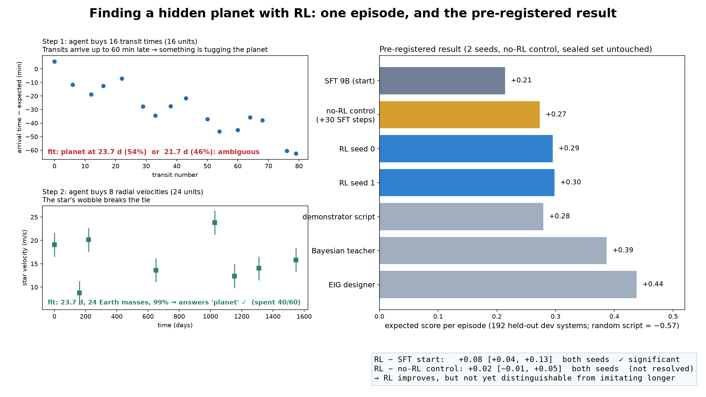

# An RL environment for scientific experimental design with exoplanets

This is a quick project to get familiar with creating RL environments; in this environment, an LLM plays the role of an astronomer and has a number of tools to determine if there is a hidden planet within a system with a start and a known exoplanet. A star has one known transiting planet; a second, hidden planet may sit near the 2:1
resonance and tug on its transit times. With a budget of 60 units (transit time = 1, radial velocity = 3) the agent decides
what to measure, when to stop, and whether to answer **"planet with period P and mass m"**, **"no planet"**, or
**"cannot be determined"**. Ground truth comes from an N-body integration (TTVFast). Built on
[Tinker](https://tinker-docs.thinkingmachines.ai/) and the `tinker_cookbook` RL loop.




## Result

Qwen3.5-9B + LoRA: SFT on 700 episodes of a scripted demonstrator, then RL (30 steps x 24 systems x 4 rollouts, reward =
posterior-expected score). Evaluation: 192 held-out dev systems, paired, sampled decoding.

| comparison (expected score, 95 % CI) | RL seed 0 | RL seed 1 |
|---|---|---|
| RL - its SFT start | **+0.081** [+0.041, +0.123] | **+0.084** [+0.045, +0.126] |
| RL - no-RL control | +0.022 [-0.010, +0.054] | +0.025 [-0.004, +0.054] |
| RL - demonstrator script | +0.016 [-0.016, +0.048] | +0.019 [-0.006, +0.044] |


## Quickstart

```bash
python -m venv .venv && .venv/bin/pip install -r requirements.txt
.venv/bin/python -m pytest tests -q                  # environment, grader and reward tests (no API needed)
bash scripts/dry_event.sh                            # the whole experiment against a fake Tinker service (free)
```

The scripts and some tests call `.venv/bin/python`, so create the virtual environment at that path.

To watch a scripted agent play through the exact text interface the model sees:

```bash
.venv/bin/python scripts/dry_run.py --agent compact --level hard --n 2 --show 2
```

## How to run

```bash
for d in fit fixed compact lite; do .venv/bin/python scripts/preflight.py --reward-mode strict0 --demo $d; done   # free gates
bash scripts/dry_event.sh                 # free plumbing check of every stage against the fake service
bash scripts/event.sh sft fixed           # SFT on the primary demonstrator + dev evals + gate
bash scripts/event.sh rl fixed 0          # RL arms, one terminal each; refused unless the gate passed
bash scripts/event.sh rl fixed 1
bash scripts/event.sh control fixed       # token-matched no-RL control
bash scripts/event.sh rl fit 0            # optional secondary arm (needs `event.sh sft fit` first)
bash scripts/event.sh final               # paired comparisons on 192 dev systems, verdicts, figure
bash scripts/event.sh sealed              # once, only if `final` names an arm
```


## Environment

- **Task generator** (`hidden_planet/tasks.py`): `sample_system(seed, level, split)` is deterministic; train/val/test use disjoint seed spaces. 35 % of systems have no perturber.
  - `easy` (level 0): circular orbits, 2:1 only, perturber 10-80 Earth masses, timing noise 0.5-1.5 min, RV noise 1-2 m/s, at most 8 turns. Solvable in about 5 tool calls.
  - `hard` (level 5, the default for evaluation): Rayleigh eccentricities (scale 0.015), 4-80 Earth masses, timing noise 0.7-3 min, RV noise 1-5 m/s, at most 14 turns.
  - Levels 1-3 add 3:2 and 4:3 aliases. They are experimental: the first-order model is not adequate there (see Physics validity).
- **Ground truth** (`--backend`, default `ttvfast`): TTVFast N-body integration (Deck, Agol, Holman & Nesvorny 2014, ApJ 787, 132), coplanar and edge-on, 151 inner orbits. `rebound` (IAS15) and `analytic` are alternatives. The scored perturber period is its mean period measured in the integration.
- **Tools** (JSON in, JSON out; `hidden_planet/text_env.py`):
  - `observe_transits(epochs)` cost 1 each; `observe_rvs(times_days)` cost 3 each; at most 16 per call.
  - `fit_transit_timing()` free: linear vs linear + sinusoid, chi-square gain, super-period, amplitude, and the perturber period each alias implies.
  - `fit_rv(periods_days)` free: K2, its uncertainty, chi-square gain and implied mass at each trial period.
  - `fit_model()` free: joint Bayesian fit with the single-perturber model; prints the probability of no perturber, the most probable period and mass with the probability each is right, and the alias probabilities. With `tool_level="lite"` it prints chi-square and BIC per alias instead, with no probabilities.
  - `get_data_summary()` free; `submit_answer(verdict, period_days, mass_earth)` ends the episode.
  - The agent gets the posterior summary but not an acquisition rule: what to buy and when to stop remain its decisions. Every tool error comes back as a message; a fuzz test checks that nothing raises.
- **Turn handling** (`NudgingEnv` in `hidden_planet/tinker_env.py`): a reply with no usable tool call costs 0.05 and gets a corrective message showing the exact syntax; after 2 such replies the episode ends as unanswered.
- **Reward** (`hidden_planet/reward.py`): score minus a cost per unit spent. An answer is right if the period is within 0.5 % and the mass within a factor 1.5. Three modes:
  - `strict0` (the pre-registered experiment, with cost 0.008 per unit): `planet` and `none` score +1 if right and -1 if wrong; `cannot_determine` scores 0. The optimal rule is to answer only when the probability of being right exceeds one half.
  - `strict`: as above with a wrong-answer penalty of 0.5, and `cannot_determine` scored as in `partial`.
  - `partial` (the library default, cost 0.005 per unit): `planet` earns +0.5 per correct component (period, mass) and -0.25 per wrong one; `none` +1 / -0.5; `cannot_determine` +0.4 if the truth was not determinable and -0.3 if it was. "Determinable" means the exact in-class posterior puts at least 0.6 on the true answer, given either the data the agent bought or full-budget reference designs on the same system.
  - In every mode an episode without a valid answer scores -1.
- **Primary metric** (`hidden_planet/expected_score.py`): the posterior-expected score, `2 p - 1` minus the observation cost for a committed answer, where `p` is the grader's posterior probability that the submitted answer is right. It has the same expectation as the `strict0` reward without the outcome luck, and is never shown to the agent.
- **Optional fourth verdict** `other` (`allow_other=True`, off by default): "a real signal that a single near-resonant perturber cannot explain". Used only for the out-of-class evaluation (`hidden_planet/ooc.py`).
- **Tinker interface**: `HiddenPlanetEnvGroupBuilder`, `HiddenPlanetDataset`, `HiddenPlanetDatasetBuilder` implement tinker-cookbook 0.6.1's `EnvGroupBuilder` / `RLDataset` / `RLDatasetBuilder`; envs are built with `build_agent_tool_env`. A group is several rollouts of the same system and noise.
- **Dry runs**: `hidden_planet/fake_tinker.py` replaces `tinker.ServiceClient` with a local fake and `hidden_planet/mock.py` supplies a scripted sampler, so the training and evaluation scripts accept `--dry-run` (`DRY=1` for the shell scripts) and exercise the real cookbook training loop, env, tokenizer and renderer without network access.

## Physics validity
- **Real data**: this environment is a controlled 2:1 world, not a tool for real systems. On archival Kepler transit times (`hidden_planet/replay.py`, `data/real/`) the scripted fit-following agent answers "planet" with wrong parameters for Kepler-88 b, whose real perturber lies outside the mass range, and raises false planets on the spotted star Kepler-17; details in `docs/HISTORY.md`.


## Limitations

- One model (Qwen3.5-9B), two RL seeds, about 3,000 RL episodes. The design could resolve an effect of roughly 0.13; the observed edge over the control is about 0.02.
- Only the 2:1 resonance is validated. Levels 1-3 (3:2, 4:3) have no trustworthy inference model, and TTVFast and REBOUND were compared only for 2:1 systems.
- `fit_model` hands the agent a calibrated posterior, so the task is sequential acquisition and stopping, not parameter inference.
- The reward constants, the tuned EIG stop rule and the 7 % model-error floor were chosen by hand or on 60 validation systems, with no sensitivity sweep.
- The out-of-class numbers in `docs/HISTORY.md` were measured on the analytic backend and were not re-run on TTVFast truth.
